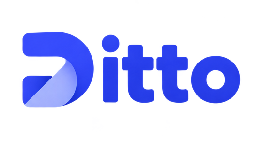

# Ditto 
# V1.0.1

	<h2><i>The Online Swiss-Army Knife</i></h2>

	

## About
Ditto is an open-source web app, REACT frontend and a Django backend, intended to group a large set of simple applications together. It is designed with modularity in mind and has a long list of new features that are in the works. 

Ditto is designed to be a lightweight application, able to be run from anywhere on simple hardware such as a Raspberry Pi.

Ditto is written by and maintained brothers <a href="https://matthewzahra.com">Matthew Zahra</a> and <a href="https://github.com/NicholasZahra6853">Nicholas Zahra</a>.

## Current Features
- Working registration, email verification, login, password change
- Inbox system and profile pictures
- Quote generator/recorder
- Restaurant recorder, including interactive map that pins recorded restaurants
- Workout tracker that tracks and graphs both cardio and gym sessions